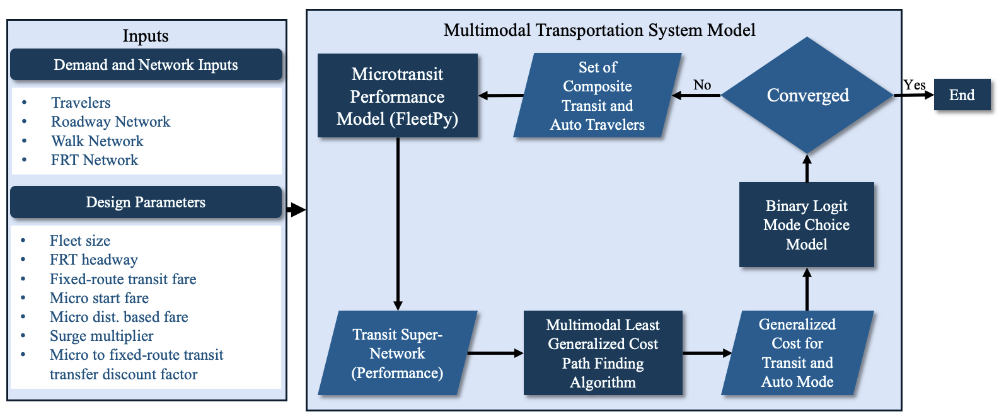

# Multimodal Transportation System Model (MTSM)

MTSM models a multimodal transportation system with microtransit (on-demand shared rides) integrated with
fixed-route transit (FRT), and the travelers' choice between transit and auto. For a given set of design parameters
(fleet size, FRT headway, fares, ...) it finds the equilibrium between microtransit demand and microtransit
performance, and reports the resulting mode shares, ridership and costs. A Bayesian optimization script
searches the design parameters for the trade-off between operator subsidy and travelers' benefit.

The microtransit service is simulated with [FleetPy](https://github.com/TUM-VT/FleetPy) (TU Munich), which is
included in `fleetpy/`.

**Study areas.** The model runs any study area whose inputs follow
[`docs/study_area_inputs.md`](docs/study_area_inputs.md) (see [Add your own study area](#add-your-own-study-area)).
The repository ships one, Lemon Grove (San Diego County), as the worked example. An earlier downtown San Diego
configuration was removed on 2026-11-08; the last version that has it is tagged `last-with-downtown-sd`. The one-time preprocessing in
`pre_process/` still mentions it ([`docs/open_issues.md`](docs/open_issues.md), I-14).



## How the model works

1. **Inputs.** Travelers (trips with origin, destination and departure time), the roadway, walk and FRT networks,
   and the design parameters: fleet size, FRT headway, FRT fare, microtransit start fare and distance-based fare,
   surge (peak) multiplier, and the microtransit-to-FRT transfer discount.
2. **Microtransit performance (FleetPy).** The microtransit trips of the current set of transit travelers are sent
   to FleetPy as requests. FleetPy simulates the fleet and returns, for each request, whether it was served and its
   wait and travel times.
3. **Transit super-network.** The microtransit performance is written into a super-network that combines walk,
   microtransit and FRT links.
4. **Multimodal least generalized cost paths.** For each traveler, the least generalized cost path is found for the
   transit mode (walk, microtransit and FRT combined) and for the auto mode.
5. **Binary logit mode choice.** Each traveler's probability of choosing composite transit or auto is computed
   from the generalized costs. A traveler without a car (`auto_available` False in the demand file, an optional
   column) takes transit.
6. **Convergence.** If the choice probabilities still change between iterations, the new set of transit and auto
   travelers goes back to step 2. Otherwise the run stops and writes its results.

Fares: FRT fare per boarding; microtransit start fare plus a distance-based fare, with a peak / off-peak factor and
transfer discounts between microtransit and FRT (the former "fare scenario 10"; the parameters `transit_fare`,
`microtransit_start_fare`, `microtransit_dist_based_rate`, `pk_fare_factor`, `off_pk_fare_factor`,
`fixed2micro_factor`, `micro2fixed_factor` of `mtsm_constant_configurations.csv`). Since 2026-11-25 the FRT
discount applies to the first FRT boarding after a microtransit ride only, and never lowers the fare of microtransit
+ FRT below the FRT fare alone; every other FRT boarding pays the full fare. The microtransit discount applies to the
start and distance fare of the first microtransit ride after an FRT ride only. The transit path search is exact for
these rules (`docs/open_issues.md` I-19, I-22, I-24, I-44).

## Running the model

Requirements: Windows (64-bit), conda, and a valid [Gurobi](https://www.gurobi.com) license (FleetPy uses Gurobi
for vehicle repositioning).

1. **Environment.** Create the locked conda environment as described in [`env/README.md`](env/README.md).
   Do not use `requirements.txt` or FleetPy's own install instructions; they do not match the verified environment.
2. **Check the inputs.** `python tools/check_inputs.py` must report that all frozen inputs match their manifests
   (`mtsm_data/MANIFEST.csv` and one per study area, e.g. `mtsm_data/lemon_grove/MANIFEST.csv`).
3. **Set the parameters.** They are in two files, one row per parameter,
   `parameter_name,parameter_value,description` (the description is for people; no code reads it):
   - the model file `mtsm_data/input_parameter/mtsm_constant_configurations.csv`: the study area (`study_area`),
     design parameters, `random_seed`, iterations and convergence, scenario lists, ...;
   - the study area's file `mtsm_data/<area>/area_parameters.csv`: its virtual-stop share, base FRT service, FRT
     line data, local prices and costs, and its time periods (names, start and end hours, peak periods).

   The names and types are in `mtsm_model/mtsm_global_parameters.py` (`AREA_PARAMETERS`: the area file's keys);
   lists are written `5;10;15`. Both are frozen inputs: to change model values, copy the model file, edit the copy
   and run with `--config <copy>` (the area file is always the one of the copy's `study_area`).
4. **Run** from the repository root, with `PYTHONHASHSEED=0` and without `PYTHONPATH`:

       python run_examples_new_parking.py                    # the frozen parameter file
       python run_examples_new_parking.py --config <file>    # another parameter file

   With `--config`, the run prints at startup which values differ from the frozen file.
   A Lemon Grove run takes about 5–7 minutes. Results are written to `mtsm_data/<area>/output/` (`<area>`: the
   parameter `study_area`; Lemon Grove: `mtsm_data/lemon_grove/output/`); the main one is
   `<area>_evaluation_zonal_partition_False.csv`: one line per metric, with the columns `FRT_only` (the base
   case: FRT only, at `base_frt_headway` and `base_frt_fare`) and `FRT_and_micro` (the scenario of the run).
5. **Check reproducibility (optional).** With the reference parameters and seed listed in
   [`docs/reference_results/README.md`](docs/reference_results/README.md), `python tools/compare_reference.py` must
   print `REPRODUCED`: the same inputs and seed give byte-identical results.

### Bayesian optimization

`python Bayesian_optimization_script.py` runs a multi-objective Bayesian optimization (Ax/BoTorch) over fleet size,
FRT headway, FRT fare, microtransit fares, peak fare factor and transfer discount. The two objectives are total subsidy
and the increase in travelers' mobility logsum due to microtransit, both relative to the base case: FRT only, at
`base_frt_headway` and `base_frt_fare` (so a candidate's shorter FRT headway adds to its subsidy). For each candidate it writes a copy of the frozen
parameter file with the candidate's values (`<folder_name>/candidate_configs/config_call_NNNN.csv`), runs the model
with `--config <copy>` and reads the evaluation file by metric name; results go to
`mtsm_data/<area>/optimization_output/LG_submission_results_R2/` (`<area>`: the frozen file's `study_area`; the
folder name is fixed in the script, I-42).
The frozen parameter file is never changed. The script sets `MKL_THREADING_LAYER=SEQUENTIAL` for itself and the model
runs it starts: without it, numpy's linear algebra crashes in the `fleetpy` env (`docs/open_issues.md`, I-27); the
model's results do not depend on it.

## Add your own study area

Lemon Grove is the worked example: every file named below exists in `mtsm_data/lemon_grove/`, and copying it is the
easiest start. [`docs/study_area_inputs.md`](docs/study_area_inputs.md) is the specification: each file's columns
and units, the node numbering, the link types and the rules that tie the files together. So far these steps have
been tested with Lemon Grove only; no second study area has been run yet.

1. **Inputs.** Create the folder `mtsm_data/<area>/`, where `<area>` is the study area's name (e.g. `my_city`), with:
   - `demand/demand.csv`: one row per traveler, with the departure time, the origin and destination walk node, and
     the traveler's travel coefficients;
   - in `networks/`: the super-network with microtransit (`super_network_micro_virstop_<v>.csv`), the FRT-only
     super-network (`super_network_frt.csv`) and the same at the base FRT headway
     (`super_network_frt_base_headway.csv`), the car network (`car_network.csv`), the FRT links (`frt_links.csv`)
     and the FRT route table (`frt_routes.csv`); a node file (`nodes.csv`) only with `aggregation = census_track`.
     The microtransit super-network and the car network can instead be given per time period
     (`..._virstop_<v>_<P>.csv`, `car_network_<P>.csv`);
   - in `fleetpy/data/`: FleetPy's road network (`networks/<area>_example_network/base/` with `nodes.csv`,
     `edges.csv`, `crs.info`) and the vehicles' start positions
     (`fleetctrl/initial_vehicle_distribution/<area>_example_network/imbalanced.csv`).

   All network files use one node numbering (walk nodes `0` to `N - 1`, then the FRT stops, then one microtransit
   node per walk node): [Node numbering](docs/study_area_inputs.md#node-numbering). Most of these files can be built
   with `TRA_input_data_prep` (below).
2. **Area parameters.** Copy `mtsm_data/lemon_grove/area_parameters.csv` into the area folder and set the area's
   values: base FRT headway and fare, FRT line data, operating costs, fuel and parking prices, and the time periods
   (`time_periods`, `period_start_h`, `period_end_h`, `peak_periods`; e.g. SANDAG ABM3's `EA;AM;MD;PM;EV`).
   `virtual_stop_scenarios` must be the `<v>` in the microtransit super-network's file name.
3. **FleetPy settings.** Copy Lemon Grove's vehicle type and its two FleetPy constant configs to the same places in
   the area folder, with `lemon_grove` replaced by `<area>` in the file names:
   - `fleetpy/data/vehicles/<area>_vehtype.csv`: vehicle capacity and costs (set `vtype_name_full` to
     `<area>_vehtype`);
   - `fleetpy/studies/example_study/scenarios/<area>_constant_config_ir_repo.csv` and
     `<area>_constant_config_ir.csv`: set `network_name` to `<area>_example_network` and `demand_name` to
     `<area>_example_demand`. FleetPy simulates from `start_time` to `end_time` (s).
4. **Check the inputs:** `python tools/check_study_area.py <area>` checks the files against the specification and
   must report no error. Every run does the same at startup and stops on an error.
5. **Manifest (optional):** `python tools/check_inputs.py --write <area>` records the checksums of the area's inputs
   in `mtsm_data/<area>/MANIFEST.csv`; a run then warns when an input has changed since.
6. **Run.** Copy the model file `mtsm_data/input_parameter/mtsm_constant_configurations.csv`, set `study_area` to
   `<area>` in the copy, and run `python run_examples_new_parking.py --config <copy>` (as in
   [Running the model](#running-the-model)). The run creates the folders it writes into.
7. **Results:** `mtsm_data/<area>/output/<area>_evaluation_zonal_partition_False.csv`, the individual results and the
   FRT ridership files in the same folder.

The optimizer works on the study area of the frozen model file. To optimize another area, set `study_area` in
`mtsm_data/input_parameter/mtsm_constant_configurations.csv` itself and rewrite the manifests with
`python tools/check_inputs.py --write <area>`; Lemon Grove then no longer reproduces the reference until the value is
set back. Not supported yet for any area: `micro_only` (microtransit without FRT) and networks per time period
([`docs/study_area_inputs.md`](docs/study_area_inputs.md#not-supported-for-a-new-study-area-for-now)).

### Building the inputs with TRA_input_data_prep

[`TRA_input_data_prep`](https://github.com/ritunuci/TRA_input_data_prep) builds the road, FRT and demand inputs from
SANDAG ABM3 (ActivitySim) outputs in the formats this model reads; for another region its scripts show how. Its
outputs and the files of this model:

| `TRA_input_data_prep` output (`outputs_MGRA15/<area>/`) | File in `mtsm_data/<area>/` |
|---|---|
| `super_network/initial_super_network_micro_hw_<h>_virstop_<v>_<P>.csv` | `networks/super_network_micro_virstop_<v>_<P>.csv` (one per period), or one period's file as `..._virstop_<v>.csv` |
| `super_network/initial_super_network_non_micro_hw_<h>_<P>.csv` | `networks/super_network_frt.csv` (one period's file: the FRT-only network is the same in every period) |
| the same with `<h>` = `base_frt_headway` | `networks/super_network_frt_base_headway.csv` |
| `super_network/auto_edges_<P>.csv` | `networks/car_network_<P>.csv` (one per period), or one period's file as `car_network.csv` |
| `frt/frt_routes.csv` | `networks/frt_routes.csv` (as it is) |
| `demand/<area>_trips_nodes_study_area_with_beta.csv` | `demand/demand.csv` (extra columns are ignored) |
| `fleetpy_network/base/` (`nodes.csv`, `edges.csv`, `crs.info`) | `fleetpy/data/networks/<area>_example_network/base/` |
| `fleetpy_network/network_dynamics.csv` and its folders (`0/`, `10800/`, ...: `edges_td_att.csv`) | the same in `fleetpy/data/networks/<area>_example_network/` (optional: FleetPy's travel times per period; without them `base/` for the whole day) |
| `fleetpy_initial_vehicle_distribution/imbalanced.csv` | `fleetpy/data/fleetctrl/initial_vehicle_distribution/<area>_example_network/imbalanced.csv` |

- `<P>`: `TRA_input_data_prep` writes one set per ABM3 time period. Since 2026-11-24 the model takes the microtransit
  super-network and the car network per period when every period of the area's `time_periods` has its file (set the
  area's periods to ABM3's, step 2), otherwise one file for the whole day. The headway `<h>` of the first two files
  does not matter: the run sets the FRT boarding times for each scenario's headway.
- Not written by `TRA_input_data_prep`: `area_parameters.csv` (step 2), the FleetPy vehicle type and constant configs
  (step 3), the node file (only for `census_track`) and `networks/frt_links.csv`: the FRT in-vehicle links (type 1)
  of the microtransit super-network, with the column `distance` named `distance (meters)`
  ([`docs/study_area_inputs.md`](docs/study_area_inputs.md#6-frt-links-networksfrt_linkscsv)).
- Freeways: with freeways, `TRA_input_data_prep` keeps walking and microtransit off them; the freeway nodes keep their
  numbers but have no walk or microtransit link, and only the car network uses them. The model accepts this since
  2026-11-24 (I-33; [Node numbering](docs/study_area_inputs.md#node-numbering)).
- The model derives the node counts from the files; `super_network_info.csv` is not needed. Lemon Grove's demand
  from `TRA_input_data_prep` has no `parking_dur_min`; without it the car has no parking cost.
- Not tested yet: a run on `TRA_input_data_prep`'s outputs (Lemon Grove's inputs were built before it).

## Repository layout

| Path | Content |
|---|---|
| `run_examples_new_parking.py` | Entry script: `--config <file>` (optional), fixes the hash seed, reads the parameters, sets the random seeds, and calls `mtsm_model.model.run_model()` |
| `mtsm_model/` | The model (see [Code map](#code-map)) |
| `Bayesian_optimization_script.py` | Bayesian optimization of the design parameters |
| `mtsm_model/helpers/` | The helper modules the model calls (see [Code map](#code-map)) |
| `pre_process/` | Preprocessing of networks and demand; `build_super_network.py` builds the super-networks (`micro`, `non_micro`, `micro_only`) and the car network from a road and an FRT network (not used by a run; identical to `TRA_input_data_prep`'s copy, with `--local-edges` for car-only roads since 2026-11-24) |
| `mtsm_paths.py` | All folder locations (imported as `mtsm`); a study area's folders from `area_paths(area)` |
| `mtsm_data/` | The model's data: frozen, checksummed inputs (`MANIFEST.csv`, one per study area) and the outputs of a run |
| `fleetpy/` | FleetPy, upstream version `7019960` with a few local changes listed in [`fleetpy/LOCAL_CHANGES.md`](fleetpy/LOCAL_CHANGES.md) |
| `env/` | Locked Python environment |
| `tools/` | `check_inputs.py`, `check_study_area.py` (a study area's inputs; also run at startup), `compare_reference.py`, `export_env.py` |
| `docs/` | Progress log, open issues, reference results |

## Code map

`run_examples_new_parking.py` fixes the hash seed, reads the parameters and calls `run_model()`. A run then goes
through the modules of `mtsm_model/` like this (the numbers are the steps of [How the model works](#how-the-model-works)):

```
run_examples_new_parking.py   config.read_run_config(), config.check_run_config(), random seeds
└─ model.run_model()
   └─ for each study area: scenarios.load_study_area()           folders, networks, travelers
      └─ for each scenario: scenarios.scenarios()                 headway, fleet size, ...
         └─ model.run_scenario(): until converged
            ├─ networks.read_iteration_networks()               3: the super-networks of this iteration
            ├─ iteration.run_iteration(): for each traveler
            │  ├─ paths.*                                        4: car, walk + FRT, walk + microtransit + FRT paths
            │  ├─ choice.*                                       5: costs, logit probabilities, random draw
            │  └─ trip_legs.*                                    legs of the chosen path -> FleetPy / FRT demand files
            ├─ convergence test (helpers/convergence_test.py)  6
            ├─ converged:     results.write_converged_results()  evaluation file, individual results
            └─ not converged: microtransit.run_fleetpy_and_update_networks()   2-3: FleetPy, network update
```

| Module | Content |
|---|---|
| `config.py` | Reads the parameter file into `PARAMETERS` (`read_constant_config()`); `RunConfig` (the run's design parameters and seed), the startup check, and the model's constants (iterations, convergence, gas costs, time periods, parking, scenario lists, node ranges) |
| `mtsm_global_parameters.py` | The names (keys) and types of all parameters (model file and area file) |
| `scenarios.py` | `StudyArea` (a study area's data) and the scenario loops (`Scenario`) |
| `model.py` | `run_model()` and `run_scenario()`, the iteration loop |
| `state.py` | `TravelerState` (per-traveler values across iterations), `BaseCase` (the fixed-route-only base case), `IterationTotals` |
| `networks.py` | Reading an iteration's super-networks |
| `iteration.py` | One iteration of the choice model for all travelers |
| `paths.py` | A traveler's networks and least generalized cost paths (car and FRT paths are reused across iterations) |
| `choice.py` | Trip costs (incl. parking), logit probabilities, logsum, mode-change threshold |
| `trip_legs.py` | Splitting a path into walk, microtransit and FRT legs |
| `microtransit.py` | Running FleetPy (through `helpers/fleetpy_runner.py`) and updating the super-networks with its results |
| `results.py` | The results of a converged scenario: costs, subsidies, individual results, evaluation file |

The helpers these modules call are in `mtsm_model/helpers/` (moved from the repository root on 2026-11-10; imported
as `from mtsm_model.helpers import network_algorithms as n_a`, ...):

| Helper | Content |
|---|---|
| `network_algorithms.py` | Reading the super-networks and travelers; the least generalized cost path search |
| `binary_choice.py`, `convergence_test.py` | Mode choice and convergence |
| `fleetpy_runner.py` | The only module that calls FleetPy: copies MTSM's FleetPy inputs into `fleetpy/` and runs it in the same process |
| `update_network_files.py`, `get_microtransit_skims.py`, `update_initial_network.py` | Updating the super-networks with FleetPy's results; microtransit skims |
| `output_performance_metrics.py`, `testing_scenario_creation.py`, `folder_directory.py` | Output metrics, scenario and folder setup |
| `synthetic_demand.py` | Synthetic microtransit requests for FleetPy (`synthesize_requests_with_trend_time`); imported by `microtransit.py`, used only by its commented-out block (I-32) |

`mtsm_paths.py` (all folder locations) stays at the root: it derives them from its own location. How the code got
this structure, and what was checked to keep the results identical, is in
[`docs/entry_script_refactor_plan.md`](docs/entry_script_refactor_plan.md).

## Documentation

- [`docs/progress.md`](docs/progress.md): what was changed to make the model reproducible and self-contained, and
  how to continue work in a fresh clone. Read this first.
- [`docs/open_issues.md`](docs/open_issues.md): known open issues.
- [`docs/study_area_inputs.md`](docs/study_area_inputs.md): what a study area must supply (the input specification);
  [`docs/study_area_plan.md`](docs/study_area_plan.md): how the model was made to run any study area, and the
  decisions.
- [`docs/reference_results/README.md`](docs/reference_results/README.md): the reference run and how to compare with it.
- [`env/README.md`](env/README.md): the environment, and what it cannot pin (OS, CPU, Gurobi license).

## License

FleetPy is MIT-licensed (see [`fleetpy/LICENSE`](fleetpy/LICENSE)).
