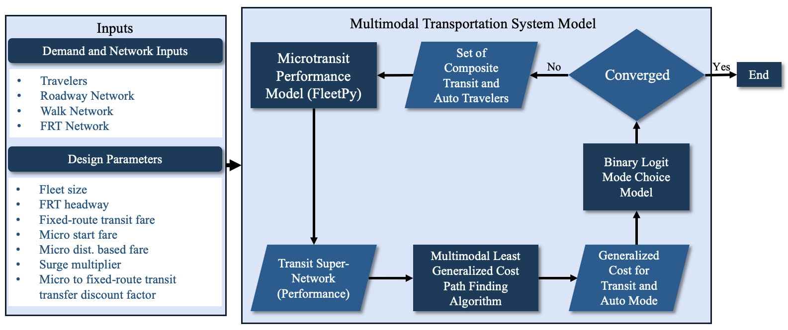

# Multimodal Transportation System Model (MTSM)

MTSM models a multimodal transportation system with microtransit (on-demand shared rides) integrated with
fixed-route transit (FRT), and the travelers' choice between transit and auto. For a given set of design parameters
(fleet size, FRT headway, fares, ...) it finds the equilibrium between microtransit demand and microtransit
performance, and reports the resulting mode shares, ridership, costs and accessibility. A Bayesian optimization script
searches the design parameters for the trade-off between operator subsidy and travelers' benefit.

The microtransit service is simulated with [FleetPy](https://github.com/TUM-VT/FleetPy) (TU Munich), which is
included in `fleetpy/`.

**Study area of this repository: Lemon Grove (San Diego County).** The code also contains a downtown San Diego
configuration, but its inputs are not in this repository and a startup check refuses to run it.

## How the model works

1. **Inputs.** Travelers (trips with origin, destination and departure time), the roadway, walk and FRT networks,
   and the design parameters: fleet size, FRT headway, FRT fare, microtransit start fare and distance-based fare,
   surge (peak) multiplier, and the microtransit-to-FRT transfer discount.
2. **Microtransit performance (FleetPy).** The microtransit trips of the current set of transit travelers are sent
   to FleetPy as requests. FleetPy simulates the fleet and returns, for each request, whether it was served and its
   wait and travel times.
3. **Transit super-network.** The microtransit performance is written into a super-network that combines walk,
   microtransit and FRT links.
4. **Multimodal least generalized cost paths.** For each traveler, the least generalized cost path is found for the
   transit mode (walk, microtransit and FRT combined) and for the auto mode.
5. **Binary logit mode choice.** Each traveler's probability of choosing composite transit or auto is computed
   from the generalized costs.
6. **Convergence.** If the choice probabilities still change between iterations, the new set of transit and auto
   travelers goes back to step 2. Otherwise the run stops and writes its results.

## Running the model

Requirements: Windows (64-bit), conda, and a valid [Gurobi](https://www.gurobi.com) license (FleetPy uses Gurobi
for vehicle repositioning).

1. **Environment.** Create the locked conda environment as described in [`env/README.md`](env/README.md).
   Do not use `requirements.txt` or FleetPy's own install instructions; they do not match the verified environment.
2. **Check the inputs.** `python tools/check_inputs.py` must report that all frozen inputs match
   `mtsm_data/MANIFEST.csv`.
3. **Set the parameters** in `mtsm_data/input_parameter/input_parameter.csv` (design parameters, `random_seed`).
4. **Run** from the repository root, with `PYTHONHASHSEED=0` and without `PYTHONPATH`:

       python run_examples_new_parking.py

   A run takes about 30 minutes. Results are written to `mtsm_data/lemon_grove/output/`; the main one is
   `lemon_grove_evaluation_zonal_partition_False.csv`.
5. **Check reproducibility (optional).** With the reference parameters and seed listed in
   [`docs/reference_results/README.md`](docs/reference_results/README.md), `python tools/compare_reference.py` must
   print `REPRODUCED`: the same inputs and seed give byte-identical results.

### Bayesian optimization

`python Bayesian_optimization_script.py` runs a multi-objective Bayesian optimization (Ax/BoTorch) over fleet size,
FRT headway, FRT fare, microtransit fares, peak fare factor and transfer discount. The two objectives are total subsidy
and the increase in travelers' mobility logsum due to microtransit. For each candidate it writes the parameters into
`input_parameter.csv`, runs the model and reads the evaluation file; results go to
`mtsm_data/lemon_grove/optimization_output/`. Note: it overwrites `input_parameter.csv`, which is a frozen input
(see [`docs/open_issues.md`](docs/open_issues.md), I-02).

## Repository layout

| Path | Content |
|---|---|
| `run_examples_new_parking.py` | Entry script: reads the inputs and runs the iteration loop above |
| `Bayesian_optimization_script.py` | Bayesian optimization of the design parameters |
| `fleetpy_runner.py` | The only module that calls FleetPy: copies MTSM's FleetPy inputs into `fleetpy/` and runs it in the same process |
| `get_microtransit_skims.py`, `get_walk_transit_skims.py`, `get_auto_skims.py`, `network_algorithms.py` | Super-networks and least generalized cost paths |
| `binary_choice.py`, `convergence_test.py` | Mode choice and convergence |
| `update_network_files.py`, `update_initial_network.py`, `output_performance_metrics.py`, `testing_scenario_creation.py`, `folder_directory.py`, `pre_process/` | Network updates, output metrics, scenario and folder setup, preprocessing |
| `mtsm_paths.py` | All folder locations (imported as `mtsm`) |
| `mtsm_data/` | The model's data: frozen, checksummed inputs (`MANIFEST.csv`) and the outputs of a run |
| `fleetpy/` | FleetPy, upstream version `7019960` with a few local changes listed in [`fleetpy/LOCAL_CHANGES.md`](fleetpy/LOCAL_CHANGES.md) |
| `env/` | Locked Python environment |
| `tools/` | `check_inputs.py`, `compare_reference.py`, `export_env.py` |
| `docs/` | Progress log, open issues, reference results |
| `standalone_scripts/` | Analysis and plotting scripts that the model run does not use |

## Documentation

- [`docs/progress.md`](docs/progress.md): what was changed to make the model reproducible and self-contained, and
  how to continue work in a fresh clone. Read this first.
- [`docs/open_issues.md`](docs/open_issues.md): known open issues.
- [`docs/reference_results/README.md`](docs/reference_results/README.md): the reference run and how to compare with it.
- [`env/README.md`](env/README.md): the environment, and what it cannot pin (OS, CPU, Gurobi license).

## License

FleetPy is MIT-licensed (see [`fleetpy/LICENSE`](fleetpy/LICENSE)).
